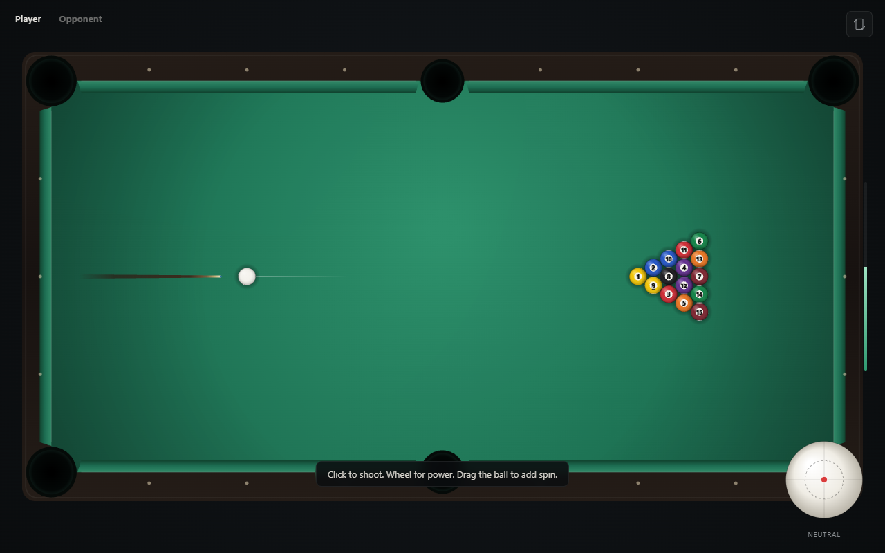
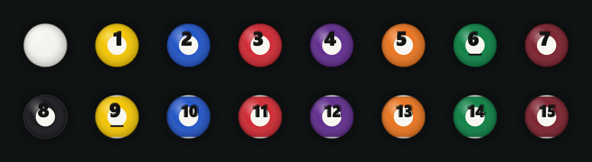

# 8ball

A top-down 8-ball pool game in the browser, with the physics written from
scratch. No physics engine, no game framework, no rendering library.



I started this to see if a browser game could get pool *physics* right rather
than just look like pool. The things that matter are draw and follow, throw on a
cut, squirt off the tip, and balls that rattle in the jaws instead of vanishing.
All of that is in here.

## Running it

```bash
npm install
npm run dev          # client on http://localhost:5173
npm run server       # in another terminal, game server on :8787
```

For a single process that serves both:

```bash
npm run build
npm run server       # http://localhost:8787
```

Node 20+.

## Playing

| | |
|---|---|
| Aim | move the mouse |
| Power | mouse wheel, or ↑ / ↓ |
| Fine aim | ← / → (hold Shift for 0.1°) |
| Spin | drag the little ball in the bottom right; double click to reset |
| Shoot | click, or Space |
| Rotate table | the button top right, or `R` |
| Ball in hand | `B` (practice only) |
| New rack | `N` (practice only) |

**Practice** is a sandbox. It is always your turn, there are no fouls, and the
8 comes back on the table if you pot it.

**Online** is two players in a room. One creates, the other joins with the
4-character code.

## Rules

Picked on the setup screen and sent to the server when the room is made, so both
players and the server are playing the same game.

Defaults: 8-ball, no called pockets, 30 second shot clock, ball in hand anywhere.

Fouls that are actually implemented: scratch, hitting nothing, wrong group
first, no rail after contact, and hitting the 8 out of turn. On a foul the other
player gets ball in hand.

## How it works

The short version: the table is simulated as an **event-driven analytic model**,
not by stepping a physics world every frame.

Between collisions a ball's path is a closed-form equation. Sliding has a
constant deceleration, rolling has a different constant deceleration, and the
moment a ball stops sliding and starts rolling can be calculated exactly. So the
simulator jumps from collision to collision instead of ticking at 60 Hz.

That buys a few things:

- no tunnelling, even at break speed (about 8 m/s, which is 4 cm per 60 Hz frame)
- no drift or jitter, no solver to tune
- the same shot always produces the same result, bit for bit
- it is cheap, because most of the time nothing is moving

Collisions are impulse-based. The normal impulse runs through both centres, so
it cannot change spin. Everything interesting comes from the **tangential
friction impulse** underneath it: that is what produces throw on a cut, spins the
object ball, and makes english work off a cushion.

There is a longer writeup in [docs/physics.md](docs/physics.md).

## Layout

```
src/core/          simulation, no DOM
  physics.ts       balls, collisions, the event loop
  table.ts         cushion segments, jaws, pockets
  rules.ts         8-ball referee (takes a list of events, returns a verdict)
  constants.ts     measured values for a 9ft table
src/render/        canvas 2d: table and balls
src/ui/            spin picker
src/app.ts         input, turn flow, playback
server/            node + ws, authoritative
shared/protocol.ts message types, imported by both sides
test/              physics, rules, rendering, multiplayer
tools/             headless renderer used by the tests and the previews
```

The simulation lives in `src/core` and imports nothing from the browser. The
server imports the same files the client does.

## Tests

```bash
npm test
```

41 tests across four files:

- **physics** — determinism, draw vs stun vs follow, squirt direction, cushion
  rebound, pocketing, balls never leaving the table
- **rules** — every foul, group assignment, the 8 winning and losing
- **visual** — renders the table and all sixteen balls to a real canvas and
  checks pixels: cloth is green, the pocket is dark, the cue ball is white, each
  ball has its own colour and a readable number
- **multiplayer** — starts a real server on a random port, connects two
  WebSocket clients, plays a break, and checks that out-of-turn shots and
  impossible spin are rejected

The visual tests run in Node using `@napi-rs/canvas` with a tiny DOM shim, so
they do not need a browser.

To write the images out and look at them yourself:

```bash
npm run shot     # docs/preview/rack.png, break.png, english.png, balls.png
```



## Multiplayer

The server is authoritative and it runs the same simulation code as the client.
A shot is about 40 bytes on the wire; the outcome is never sent by a client.

```
client sends { aim, spin, power }
server simulates, judges, broadcasts { shot, state }
both clients animate from the shot, then adopt the server's table
```

That means a client cannot report a fake result, because it never reports one.
The client still simulates locally for instant feedback and gets corrected by the
next state message if it ever drifts.

One process, one port, no database for live games. Rooms are a `Map` and a room
clock sweeps the whole server once a second.

## What is simplified

Being honest about the edges, since this is meant to be readable rather than
complete:

- **No masse.** Sidespin does not curve the ball in flight, only off rails and
  through throw. Real masse needs cue elevation, which is not modelled.
- **Pockets are a test, not geometry.** A ball is pocketed when its centre leaves
  the playing rectangle. It can only do that through a gap between cushions, so
  it works, but there is no proper pocket cut behind it.
- **Jaws are circles.** They rattle balls out, which is the important part, but
  they are not the angled cushion ends of a real table.
- **Called pockets** exists in the rules engine but there is no UI for calling a
  pocket yet, so the option is disabled in the menu.
- **8 on the break** re-racks instead of spotting.
- **No jump shots.** Cue elevation is not in the input model.
- **No sound.** It would help a lot and it is not there.

## If I kept going

Sound first — collision-triggered, volume from impact speed. It does more for
"this feels like pool" than another week of physics.

Then a shot preview that is honest about squirt, and a proper called-pocket UI.
