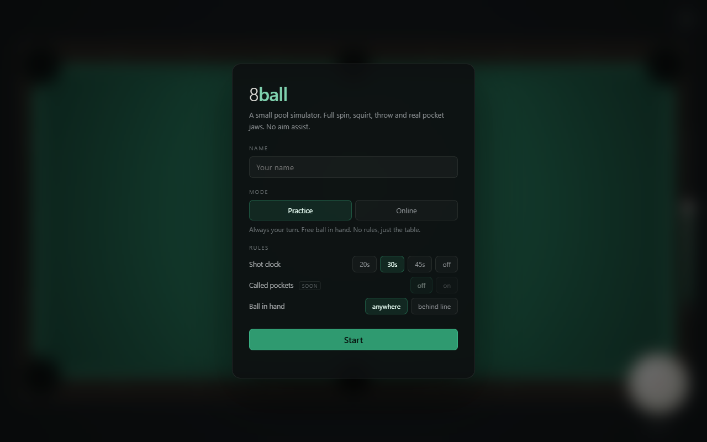
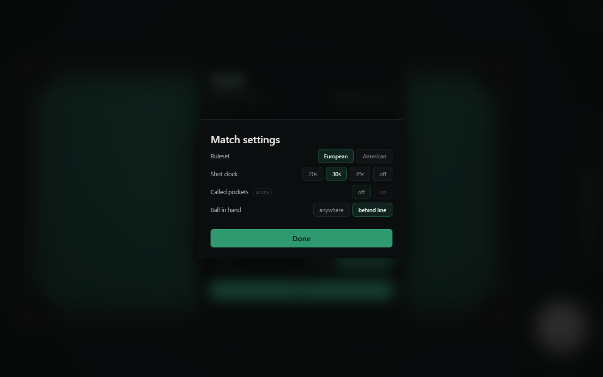
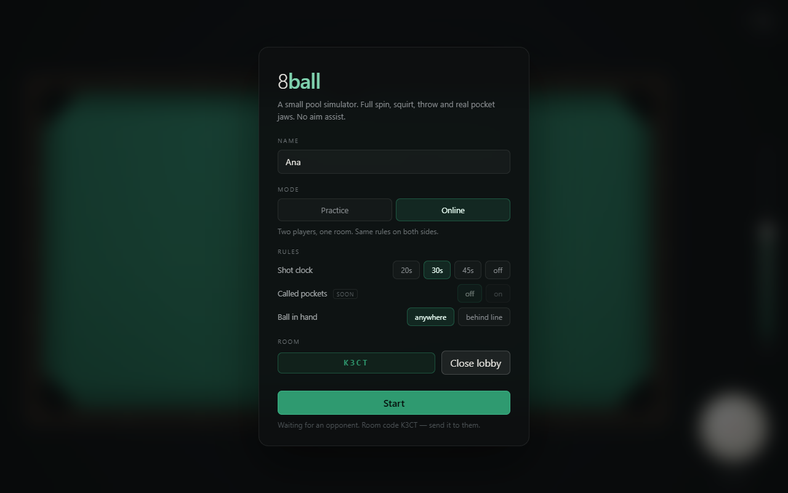
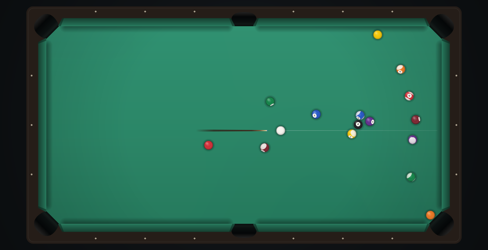

# 8ball

A top-down 8-ball pool game in the browser. The physics is written from
scratch — no physics engine, no game framework, no rendering library.


I built it to see how close a browser game could get to real pool *physics*,
not just to something that looks like pool. Draw and follow, throw on a cut,
squirt off the tip, balls that rattle in the jaws instead of disappearing — it
is all in here, and none of it is faked with animation.

## Running it

```bash
npm install
npm run dev          # client on http://localhost:5173
npm run server       # game server on :8787, in another terminal
```

Or one process for both:

```bash
npm run build
npm run server       # http://localhost:8787
```

Node 20+.

Deployment is one Node process behind Caddy, listening on loopback only — see
[deploy/README.md](deploy/README.md).

## The menu



Online is the default. Two players, one room: one creates it, the other joins
with the 4-character code. Practice is a sandbox — always your turn, no fouls,
the 8 comes back if you pot it.

Match settings are one click away rather than spread over the screen:



## Playing

| | |
|---|---|
| Aim | move the mouse |
| Power | the bar on the right, or ↑ / ↓ |
| Fine aim | ← / →, hold Shift for smaller steps |
| Spin | the ball in the bottom right, double click to reset |
| Shoot | click, or Space |
| Rotate table | the button top right, or `R` |
| Ball in hand | `B` (practice) |
| New rack | `N` (practice) |

## Rules

The ruleset is picked before the match and sent with the room, so the server
and both players are refereeing the same game.

**European (default)** differs in one way only: the break has to pot a ball or
drive two object balls to a cushion. Anything less is a foul.

**American** lets a break off as long as it makes contact with something.

A foul in either is the turn and a ball in hand — nothing more. There is no
second visit, no extra shot, no carry.

Fouls: scratch, hitting nothing, wrong group first, no rail after contact,
hitting the 8 out of turn. Potting the 8 before clearing your group loses;
potting it after clearing wins.

## Sound

Synthesised, no audio files. Every contact gets a voice of its own, with pitch
and volume from its impact speed, scheduled against the audio clock the moment
a shot is known. A break is 30-odd contacts in a third of a second, so voices
are bucketed and capped per 60 ms window — uncapped it is a buzz, not a sound.

Because it is scheduled rather than triggered per frame, a shot still plays
correctly when the tab is in the background.

## How it works

The table is an **event-driven analytic model**, not a physics world stepped
every frame.

Between collisions a ball's path is a closed-form equation: sliding has one
constant deceleration, rolling has another, and the instant a ball stops
sliding and starts rolling is calculable exactly. The simulator jumps from
collision to collision instead of ticking at 60 Hz.

That means no tunnelling at break speed, no drift or jitter, no solver to tune,
and identical results every run — which is what lets the server settle the
final positions online.

Collisions are impulse-based. The normal impulse passes through both centres,
so it cannot change spin. Everything interesting comes from the **tangential
friction impulse** underneath it: throw on a cut, spin on the object ball,
english off a cushion.

There is a longer writeup in [docs/physics.md](docs/physics.md).


## Multiplayer

The server is authoritative and runs the same simulation code as the client. A
shot is about 60 bytes on the wire: aim, power, spin. The outcome is never sent
by a client.

```
client sends { aim, spin, power }
server simulates, judges, broadcasts { shot, state }
both clients animate from the shot, then adopt the server's table
```

A client cannot report a fake result because it never reports one. It does
simulate locally for instant feedback, and compares its result against the
server's — if they ever differ it warns and lets the server's board win.

One process, one port, no database. Rooms are a `Map`; a single interval sweeps
every room's shot clock.



## Layout

```
src/core/          simulation, no DOM
  physics.ts       balls, collisions, the event loop
  table.ts         cushion segments, jaws, pockets
  rules.ts         the referee (takes a list of events, returns a verdict)
  constants.ts     measured values for a 9ft table
src/render/        canvas 2d: table and balls
src/audio.ts       synthesised contact sounds
src/ui/            spin picker
src/app.ts         input, turn flow, playback
server/            node + ws, authoritative
shared/protocol.ts message types, imported by both sides
test/              physics, rules, rendering, multiplayer
tools/             headless renderer used by the tests and the previews
```

`src/core` imports nothing from the browser. The server imports the same files
the client does.

## Tests

```bash
npm test
```

- **physics** — determinism, draw vs stun vs follow, squirt direction, cushion
  rebound, pocketing, balls never leaving the table
- **rules** — every foul, group assignment, the break requirement, a foul
  handing over the turn exactly once, and the 8 winning and losing
- **visual** — renders the table and all sixteen balls to a real canvas and
  checks pixels
- **multiplayer** — starts a real server, connects two WebSocket clients, plays
  a break, and checks that out-of-turn shots and impossible spin are rejected

The visual tests run in Node with a small DOM shim, so they need no browser.

To write the previews out yourself:

```bash
npx tsx tools/render.ts        # table, balls, break
node tools/browser-check.mjs   # the real app in Edge, plus console errors
```



## What is simplified

- **No masse.** Sidespin does not curve the ball in flight, only off rails and
  through throw. Real masse needs cue elevation, which is not modelled.
- **The table is 9ft with 2¼" balls** — American dimensions. Real blackball is
  a 7ft table with 2" balls.
- **Called pockets** exists in the referee but has no UI, so it is disabled.
- **8 on the break** re-racks instead of spotting.
- **No jump shots**, and no push-out after a foul.
- **Pocket depth is visual.** The ball is pocketed when its centre crosses the
  mouth.

## If I kept going

Reconnection, so a dropped tab does not lose the room. Then a proper
called-pocket UI, and cue elevation for masse and jump shots.
